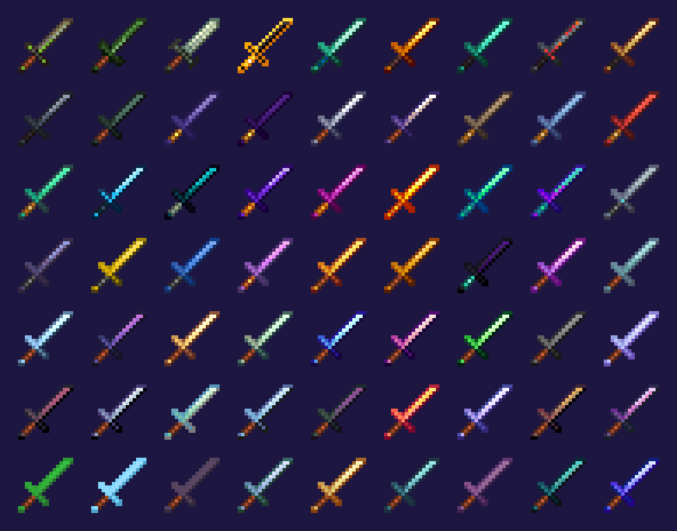

# Spartan Compat

{ width="128" align=right }

Spartan Compat adds all 24 Spartan Weaponry weapon types in the metals and gems of other mods. Version 1.1.0 has 63 materials from 24 mods on NeoForge 1.21.1, and 51 materials from 21 mods on Forge 1.20.1.

Each material has its own trait. Fiery weapons set things on fire, Knightmetal breaks armor, Neptunium hits anything in water 50% harder and Warden weapons blind what they hit. Botania weapons mend themselves from the mana in your inventory, Eternal Starlight ones freeze, poison or burn, and Psi weapons hold spell bullets and cast on hit. A few materials, like Amaramber and Sculkium, have no ability and just bring their own stats.

You craft them like the iron versions. The late Cataclysm metals are the exception, and you smith those up from netherite weapons. Every material mod is optional, and a material only shows up when its mod is installed.

## Versions and requirements

| Minecraft | Loader | Version | Materials | Required weapon mod |
|---|---|---|---|---|
| 1.21.1 | NeoForge | 1.1.0 | 63 from 24 mods | [Spartan Weaponry Unofficial](https://www.curseforge.com/projects/1450963) 1.2.3 or newer |
| 1.20.1 | Forge | 1.1.0 | 51 from 21 mods | [Spartan Weaponry](https://www.curseforge.com/projects/278141) 3.2.1 |

The 1.20.1 file has no Thaumaturge, Eternal Starlight or Eidolon materials.

[CurseForge project](https://www.curseforge.com/projects/1802929)

## Material mods

Install only the ones you want.

| Mod | Materials |
|---|---|
| [The Twilight Forest](https://www.curseforge.com/projects/227639) | Ironwood, Steeleaf, Knightmetal, Fiery |
| [Aquaculture 2](https://www.curseforge.com/projects/60028) | Neptunium |
| [L_Ender's Cataclysm](https://www.curseforge.com/projects/551586) | Ignitium, Cursium, Witherite, Ancient Metal, Black Steel |
| [Caverns & Chasms](https://www.curseforge.com/projects/438005) | Necromium |
| [Thaumaturge](https://www.curseforge.com/projects/1628024) (1.21.1 only) | Thaumium, Void Metal |
| Ultima Ratio | Starsteel, Eclipse |
| The Undergarden | Cloggrum, Froststeel, Utherium, Forgotten |
| Deeper and Darker | Resonarium, Warden |
| The Aether | Zanite, Gravitite |
| Allthemodium | Allthemodium, Vibranium, Unobtainium |
| Mekanism Tools | Osmium, Refined Obsidian, Refined Glowstone, Lapis Lazuli |
| Malum | Soul Stained Steel, Hallowed Gold |
| Forbidden Arcanus | Deorum, Draco Arcanus |
| [Create](https://www.curseforge.com/projects/328085) | Brass, Zinc |
| [Ars Nouveau](https://www.curseforge.com/projects/401955) | Source Gem |
| [Occultism](https://www.curseforge.com/projects/361026) | Iesnium |
| [Applied Energistics 2](https://www.curseforge.com/projects/223794) | Certus Quartz, Fluix |
| [Botania](https://www.curseforge.com/projects/225643) | Manasteel, Elementium, Terrasteel |
| Ender IO | Dark Steel, which beheads and holds its own energy |
| Psi | Psimetal |
| Eternal Starlight (1.21.1 only) | Amaramber, Deepsilver, Flowglaze, Glacite, Malarite, Starfire, Starlit Diamond, Thermal Springstone, Unrealium |
| Nature's Aura | Infused Iron, Sky, Depth |
| Eidolon Repraised (1.21.1 only) | Silver |
| L2 Complements | Eternium, Poseidite, Sculkium, Shulkerate, Totemic Gold |

## For pack makers

The config file is written on first start at config/spartan_compat/materials.json. You can turn any mod's weapons off, or force them on without the mod, and change each material's durability, damage, speed, enchantability and traits. Changes need a restart. Traits come from item tags, so a datapack can move them around too. KubeJS can edit the recipes like any others.

## Credits and license

By Oculifelis. The code is MIT. The Twilight Forest, Cataclysm, Aquaculture and Caverns & Chasms textures come from the earlier Spartan add-ons by KreloX, Cephelo and denispionicul (MIT). The rest are Spartan Weaponry's own sprites by ObliviousSpartan, recolored (Apache-2.0).
