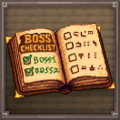

# Boss Checklist (Unofficial NeoForge port)

{ width="128" align=right }

A NeoForge port of [Boss Checklist](https://github.com/yori3o/BossChecklist) by Yori3o, for Minecraft 26.1.2, 26.2 and
26.3. It is not made or supported by Yori3o. Report port problems at
[Oculifelis/BossChecklist](https://github.com/Oculifelis/BossChecklist).

Boss Checklist adds a list of every boss in the modpack, with a model of each boss, its drops, health and armor. It opens
from a button in the pause menu or a key (Open Checklist, unbound by default under Controls). The mod works on the client
alone. Installed on the server too, it marks bosses as defeated by itself.

| Minecraft | Loader | Boss Checklist |
|---|---|---|
| 26.1.2 | NeoForge 26.1.2.122 or newer | 5.3.1+neoforge-26.1.2 |
| 26.2 | NeoForge 26.2.0.90 or newer | 5.3.1+neoforge-26.2 |
| 26.3 | NeoForge 26.3.0.101 or newer | 5.3.1+neoforge-26.3 |

[CurseForge project](https://www.curseforge.com/projects/1807839)

## For pack makers

The boss list is data, read from every mod, resource pack and data pack. The port keeps the original's file formats, so
Boss Checklist files written for the Fabric version work unchanged.

| File | Side | What it sets |
|---|---|---|
| `assets/boss_checklist/bosses.json` | Client (resource pack) | The checklist entries. 173 bosses from popular mods ship by default. |
| `data/boss_checklist/server_bosses_ids.json` | Server (data pack) | Which entities count as bosses for automatic marking. |

Each entry in `bosses.json` names the entity `id` and may set `drops` (an item id, with `#10%` after it for a chance),
`position` in the list, `type` (1 boss, 2 miniboss), `health`, `armor`, `wiki_link`, and the model's `scale`,
`y_offset` and `rotate_y`. The list can also be changed in game with the built-in editor.

## Credits and licence

Boss Checklist is by **Yori3o**. NeoForge port by **Oculifelis**. Both are under the MIT licence.
