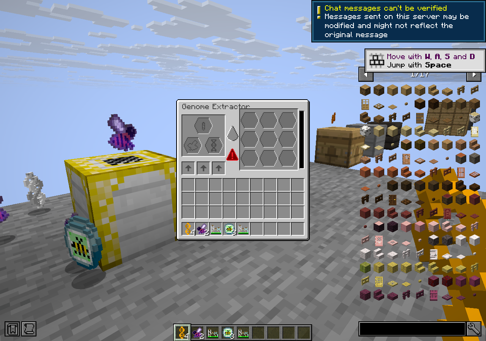
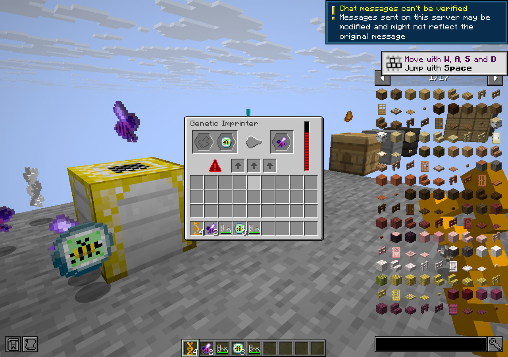

# Genetic Industry Unofficial

{ width="140" align=right }

Extract individual genes from bees, collect them on a Genetic Template, and imprint the finished genome onto a princess or drone. This is a port of TheSmartNoob880's Genetic Industry for [Complicated Bees Unofficial](../../complicatedbees/index.md).

**Requires** [Complicated Bees Unofficial](../../complicatedbees/index.md) 3.6.2 for your Minecraft version. The port was built against port.5. **Optional:** [JEI](https://www.curseforge.com/projects/238222) shows the machine recipes and template crafting. [Jade](https://www.curseforge.com/projects/324717) is also optional. Neither is bundled.

| Minecraft | Loader | Genetic Industry |
|---|---|---|
| 26.1.2 | NeoForge 26.1.2.122 or newer | 1.0.0+26.1.2-port.3 |
| 26.2 | NeoForge 26.2.0.93 or newer | 1.0.0+26.2-port.3 |

[CurseForge project](https://www.curseforge.com/projects/1795173)

## The two machines

| Machine | What goes in | What comes out |
|---|---|---|
| Genome Extractor | A princess or drone, a Blank Gene Sample and labware | A random gene from either chromosome on a successful run. The bee is consumed. |
| Genetic Imprinter | A complete Genetic Template and a princess or drone | The same bee, with both chromosomes set to the template's genome. The template is reusable. |

Both machines run on RF and have three slots for Complicated Bees machine upgrades. The Extractor recipe uses a Microscope and diamonds. The Imprinter uses an Autolyzer, an echo shard and four Royal Ingots.

## Genes and templates

Craft a filled gene sample with a Genetic Template to add the gene. A complete template holds all 12 genes: species, lifespan, productivity, fertility, temperature, humidity, flower, territory, effect, active time, cave dwelling and weatherproofing. A new sample for a gene already on the template replaces it. Smelt samples and templates back to blanks to reuse them.

| Picture | Labware | Chance to extract | Uses |
|---|---|---|---|
| { .mc-icon } | Basic | 50% | 1 |
| { .mc-icon } | Improved | 75% | 16 |
| { .mc-icon } | Advanced | 100% | 64 |

## For pack makers

These are the defaults before upgrades. All three values for each machine can be changed in the mod config.

| Machine | Capacity | RF per tick | Ticks per run |
|---|---|---|---|
| Genome Extractor | 100,000 RF | 500 | 100 |
| Genetic Imprinter | 500,000 RF | 1,000 | 100 |

The crafting recipes are under <code>data/genindustry_bees/recipe/</code>.

## Credits and licence

Genetic Industry is by TheSmartNoob880, with code help from Emperdog and most textures by Filostorm. Port by **Oculifelis**. The port is licensed [GPL-3.0-only](https://www.gnu.org/licenses/gpl-3.0.html).
