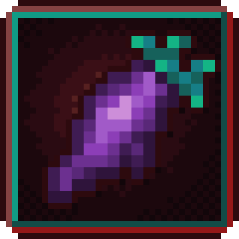

# Ports

Other authors' mods, ported by Oculifelis to newer Minecraft versions or loaders. Each one is marked "Unofficial": it is
not made or supported by the original author, so report problems with a port to its own repository, not to them. The
original's ids, recipes and values are kept, and the original author is credited on each page.

| Picture | Port | What it does |
|---|---|---|
| { .mc-icon } | **[Nether Agriculture (Unofficial)](../netheragriculture/index.md)** | NetherDon's Nether farming mod, ported to 26.1.2, 26.2 and 26.3 on NeoForge and Fabric. Berries, Lothun, Blaze Fruit and Azure Melons, hoglin and strider meat, the Black Furnace and a glowing wood set. |
