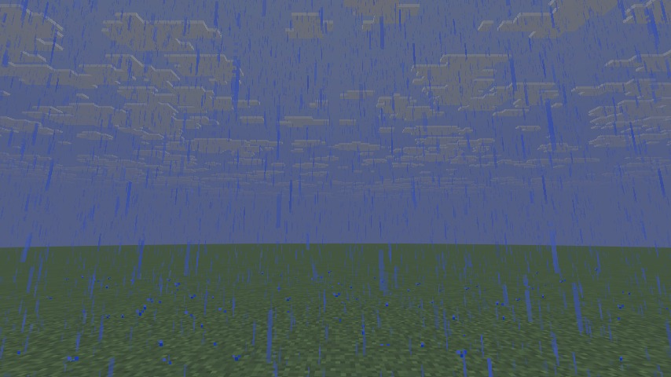
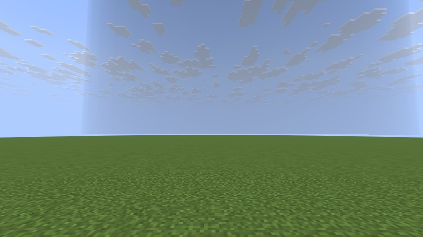
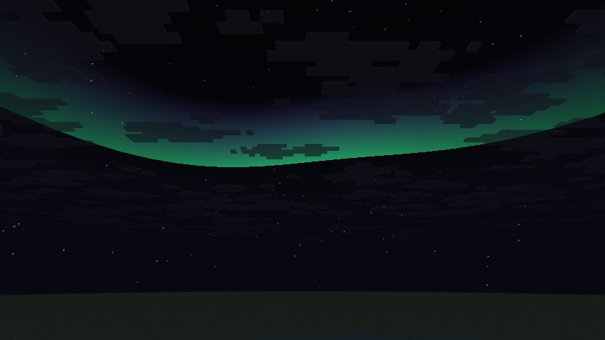

# Procella

Procella swaps the world-wide weather for storm fronts that move across the Overworld. Rain falls only under a front,
so it can pour on one village while the next one stays dry. A front shows on the horizon as a grey curtain of rain
before it arrives, and cold biomes get auroras at night.

**Requires** only NeoForge. No other mods are needed.

| Minecraft | Loader | Procella |
|---|---|---|
| 26.1.2 | NeoForge | 0.1.0.1 |

This guide covers the built **0.1.0.1** jar. It is not released yet.

## Weather fronts

Fronts form 320 to 800 blocks away from a player and travel toward them. Up to 16 can be active at once. Fronts grow
stronger over the ocean and weaker over mountains, badlands and other hot, dry land. The sky darkens under a front,
and thunder comes and goes with it.

| Front | Size (radius) | Speed | Thunder | Pressure drop |
|---|---|---|---|---|
| Rain band | 280 blocks | slow | rare | 8 hPa |
| Thunder squall | 220 blocks | fast | almost always | 18 hPa |
| Snow squall | 240 blocks | medium | rare | 12 hPa |
| Dry lightning | 190 blocks | medium | almost always, with no rain | 14 hPa |

The vanilla `/weather rain` and `/weather thunder` commands start a front over the player at full strength, and
`/weather clear` clears the fronts within 512 blocks.

## Rain curtains

A front farther than 192 blocks away shows as a tall sheet of rain on the horizon, so a storm can be seen coming long
before it arrives.

## Auroras

At night in cold biomes, auroras hang over the horizon. They glow brighter under a bright moon and near a passing
front, most of all a snow squall. Two palettes ship with the mod, a green boreal one and a violet one, and they take
turns with the moon phase. With a shader pack on, the auroras dim themselves so they don't clash with it. This can
be turned off.

## The Barometer

The Barometer reads the air pressure where the player stands. Normal air is 1013 hPa, and each front nearby pulls it
down. A reading below 1004 hPa means a storm front is close.

## Config

| Setting | Side | What it does |
|---|---|---|
| `renderQuality` | client | Detail of the rain curtains and auroras. |
| `enableAuroras` | client | Turns auroras on or off. |
| `enableRainCurtains` | client | Turns rain curtains on or off. |
| `degradeWithShaderPacks` | client | Dims auroras while a shader pack is on. |
| `maxActiveFronts` | server | Most fronts at once, 16 by default. |
| `simTickInterval` | server | How often fronts move and change. |
| `syncIntervalTicks` | server | How often players get front updates. |
| `syncRadiusBlocks` | server | How far away a front is still sent to a player, 2048 blocks by default. |

## For pack makers

Front types and aurora palettes are datapack JSON, so packs can add new storms and new aurora colours.

| Path | What it sets |
|---|---|
| `data/<namespace>/procella/front_types/` | Each front's size, speed, rain or snow, thunder chance, pressure drop, and how fast it grows over the ocean and fades over land. |
| `data/<namespace>/procella/aurora_palettes/` | Each aurora's colours, curtain speed, height and how much it glows on dark nights. |
| `data/<namespace>/procella/item_tuning/barometer.json` | The pressure where the Barometer warns of a storm. |

Procella is All Rights Reserved.
