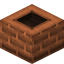
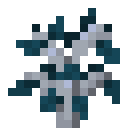
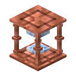
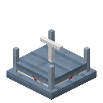
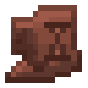
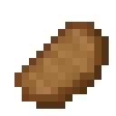
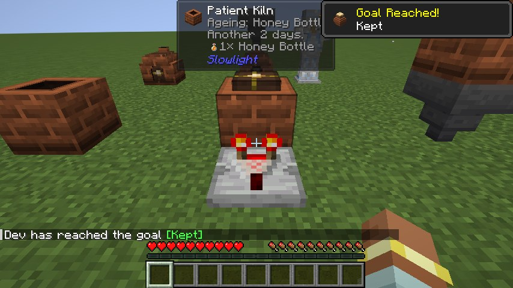

# Slowlight

*Some things are better left to take their time.*

Slowlight is a small mod about waiting. Its kilns burn no fuel and have no screen and no progress bar: put something
in, shut the lid and walk away, and when you come back a day or a week later it's done. The wait runs on the world's
own clock, so sleeping through the night won't hurry it, and leaving the chunk won't lose it.

Everything else follows from that: a lantern that keeps the opposite hours to everyone else, a sandglass that measures
days, flowers pressed over three of them, wood that silvers in the weather, and three records that take longer to
press than to play.

**Requires** nothing but NeoForge (Forge on 1.20.1). **Optional:** JEI (every kiln recipe, with its days and
weather), Jade (how long a kiln, Sandglass or Keepsake Urn has left), Patchouli (*A Slow Almanac*), KubeJS, Create,
Chipped, Rechiseled, and the mods under [Other mods](items.md#other-mods).

**Versions:** 1.21.1 NeoForge is the main version; there are ports for 1.20.1 Forge and NeoForge 26.1.2, 26.2 and
26.3, all at 0.8.2. See [Versions](versions.md) for what differs on each.

## What's in it

| | | |
|---|---|---|
| { .mc-icon } | **[The kilns](kilns.md)** | the Patient, Long and Ember Kilns, and how the wait works |
| { .mc-icon } | **[Kiln recipes](recipes.md)** | all 100 ageing recipes, with their days and weather |
| { .mc-icon } | **[Light and shards](items.md#light-that-keeps-its-own-hours)** | the Slowlight Lantern, Slowlight and Still Shards, the Patience trim |
| { .mc-icon } | **[Growing things](items.md#growing-things)** | Duskbloom, Gloamwood and Lanternfruit |
| { .mc-icon } | **[Measuring time](items.md#measuring-time)** | the Sandglass, the Sundial and the Keepsake Urn |
| { .mc-icon } | **[Slow crafts](items.md#slow-crafts)** | weathering Gloamwood, the Flower Press, the Slow Candle |
| { .mc-icon } | **[To build with](items.md#to-build-with)** | shard blocks, patterned planks, bookshelves, the Lapse Block |
| { .mc-icon } | **[Potters and old yards](items.md#potters-and-old-yards)** | the Potter villager, kiln ruins and the Patience sherd |
| { .mc-icon } | **[Three records](items.md#three-records)** | Patient Light, Lantern Hours and A Week In |
| { .mc-icon } | **[Other mods](items.md#other-mods)** | foods and recipes for Twilight Forest, The Undergarden, The Aether and Aerial Hell |
| | **[For pack makers](packs.md)** | the `slowlight:ageing` recipe type, from datapacks and KubeJS |

## Credits

By **Oculifelis**.

The Pressed Flower petal shapes are cut from vanilla Pink Petals and Wildflowers, Lithoform's wisteria petals and
petal litter (Apache-2.0), World of Wonder's mellow petals (LGPL-3.0), and Cosmopolitan's and Maple's petals (MIT).
