# Everything else

Every crafting recipe shows in JEI. Kiln recipes are on [their own page](recipes.md).

## Light that keeps its own hours

| | Item | How to get it | What it does |
|---|---|---|---|
| { .mc-icon } | **Slowlight Lantern** | copper ingots, glass panes and a Slowlight Shard | dim through the day, bright from dusk to dawn; underground, where the sky never brightens, it simply stays up |
| { .mc-icon } | **Slowlight Shard** | an amethyst shard, 7 days in a kiln; dried Duskbloom petals, 14 nights under open sky; sometimes dug up by sniffers | the lantern is built around one |
| 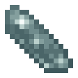{ .mc-icon } | **Still Shard** | an ender pearl, 10 days in a kiln in the End with nothing above it | the End has no day and no weather, so the pearl goes quiet and still |
| { .mc-icon } { .mc-icon } | **Shard clusters** | | decoration that glows faintly |
| 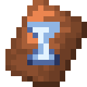{ .mc-icon } | **Patience Armor Trim** | a Slowlight Shard, 14 days in a kiln; master Potters | stamps an hourglass on armour; both shards also work as trim materials |

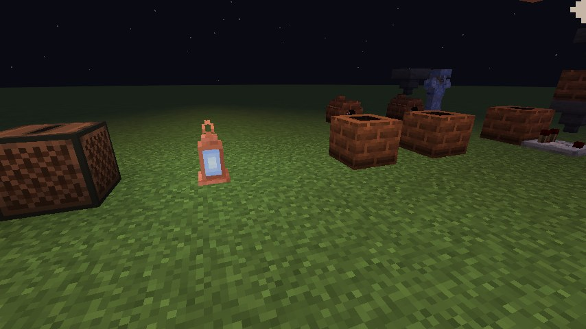

## Three records

Each is pressed slowly out of a vanilla disc in the kiln, and plays in any jukebox. Each is rather shorter than the wait
for it.

| | Record | Pressed from | Days |
|---|---|---|---|
| 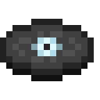{ .mc-icon } | **Patient Light** | *mellohi* | 4 |
| 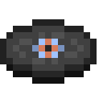{ .mc-icon } | **Lantern Hours** | *stal* | 5 |
| 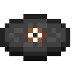{ .mc-icon } | **A Week In** | *far* | 7 (as you might expect) |

## Growing things

**Duskbloom.** { .mc-icon .mc-inline } Sniffers dig up Duskbloom Seeds, a
farmland crop that grows only at night. Ripe, it glows faintly and gives
{ .mc-icon .mc-inline } Duskbloom Petals, which make:

- light blue dye;
- { .mc-icon .mc-inline } dried petals (a day in the sun in a
  kiln), for 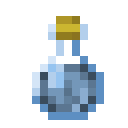{ .mc-icon .mc-inline } Duskbloom Tea and
  { .mc-icon .mc-inline } Dusk Cider;
- { .mc-icon .mc-inline } Duskbloom Jam, stirred into Preserved Berries;
- a Slowlight Shard, once dried and left two weeks under the night sky.

**Gloamwood.** A blue-grey tree with a full set of wood. Its seedling grows from Lanternfruit seeds left a week in a
kiln.

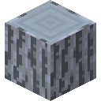{ .mc-icon title="Gloamwood Log" } 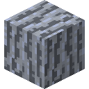{ .mc-icon title="Gloamwood Wood" } { .mc-icon title="Stripped Gloamwood Log" } { .mc-icon title="Stripped Gloamwood Wood" } 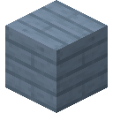{ .mc-icon title="Gloamwood Planks" } 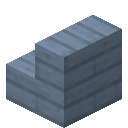{ .mc-icon title="Gloamwood Stairs" } 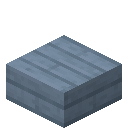{ .mc-icon title="Gloamwood Slab" } { .mc-icon title="Gloamwood Fence" } 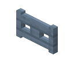{ .mc-icon title="Gloamwood Fence Gate" } { .mc-icon title="Gloamwood Door" } 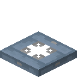{ .mc-icon title="Gloamwood Trapdoor" } 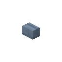{ .mc-icon title="Gloamwood Button" } 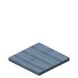{ .mc-icon title="Gloamwood Pressure Plate" } 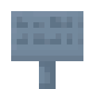{ .mc-icon title="Gloamwood Sign" } { .mc-icon title="Gloamwood Hanging Sign" } 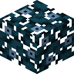{ .mc-icon title="Gloamwood Leaves" } 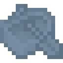{ .mc-icon title="Gloamwood Boat" } 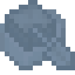{ .mc-icon title="Gloamwood Boat with Chest" }

**Lanternfruit.** 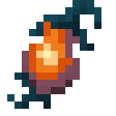{ .mc-icon .mc-inline } Lanternfruit hangs under Gloamwood
leaves and glows from within when ripe. It gives 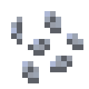{ .mc-icon .mc-inline }
seeds, 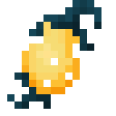{ .mc-icon .mc-inline } candied fruit and
{ .mc-icon .mc-inline } preserve,
{ .mc-icon .mc-inline } must (a glass bottle, two fruit and sugar) for
{ .mc-icon .mc-inline } Lanternwine, and
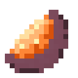{ .mc-icon .mc-inline } peel. Four peels round a torch make a
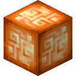{ .mc-icon .mc-inline } **Lanternfruit Lamp**.

## Measuring time

| | Block | Crafted from | What it does |
|---|---|---|---|
| 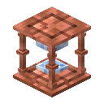{ .mc-icon } | **Sandglass** | copper ingots, glass and a Slowlight Shard | an hourglass that measures days. Click it to set one to seven; the sand runs down over those days, and when the last grain falls it gives one redstone pulse and turns itself over. A comparator reads how much sand is left. In the Nether and the End it can't find the time, and the sand never settles. |
| 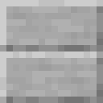{ .mc-icon } | **Sundial** | a copper ingot, a Slowlight Shard and a smooth stone slab | tells the hours of one day. Under open sky a comparator reads its shadow: nothing all night, full strength at noon. Roofed over, no shadow falls. |
| 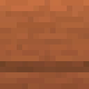{ .mc-icon } | **Keepsake Urn** | terracotta and string | nine slots for putting things away for later. Choose one to thirty days, then seal it with a honeycomb. Until the days are up it won't open, not for you and not for a hopper. Break it early and it cracks, and everything spills out. |

## Slow crafts

**Weathering Gloamwood.** Gloamwood planks, stairs and slabs left under open sky fade, then weather, then silver, in
patchy steps, the way copper does. Honeycomb waxes them where they are, and an axe scrapes them back.

{ .mc-icon title="Gloamwood Planks" } 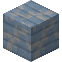{ .mc-icon title="Faded Gloamwood Planks" } 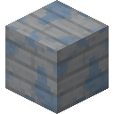{ .mc-icon title="Weathered Gloamwood Planks" } 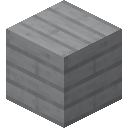{ .mc-icon title="Silvered Gloamwood Planks" }

**Flower Press.** 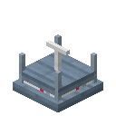{ .mc-icon .mc-inline } (Gloamwood slabs, paper and an iron
nugget.) It takes any flower in `#slowlight:pressable` (every vanilla flower, any modded one in `#c:flowers`, and
Aerial Hell's) and over three days gives back a **Pressed Flower**. Lay them on the ground, up to four to a block like
Pink Petals, or on a wall. Each one is drawn in its own flower's colours, in one of 47 petal shapes chosen by the size
of the bloom and whether it has a second colour. A flower that glows still glows when it's pressed.

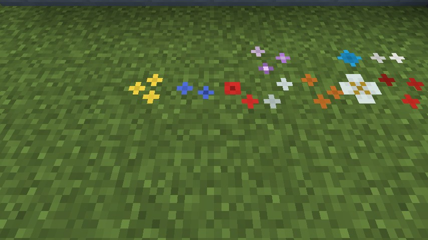

**Slow Candle.** 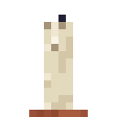{ .mc-icon .mc-inline } (String, honeycomb and a copper ingot.)
Burns down over four lit days.

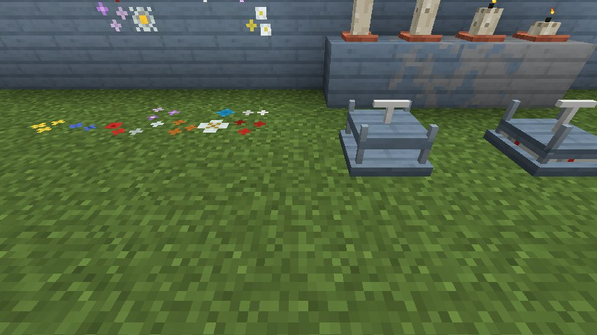

## To build with

**Slowlight Shard and Still Shard blocks.** Nine shards make a block; the stonecutter (or Rechiseled's chisel) cuts it
into eleven designs, each with stairs and slabs.

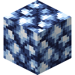{ .mc-icon title="Block of Slowlight Shard" } { .mc-icon title="Chiseled Block of Slowlight Shard" } { .mc-icon title="Chiseled Cubes Block of Slowlight Shard" } 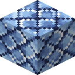{ .mc-icon title="Diagonal Tiles Block of Slowlight Shard" } 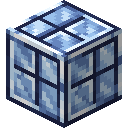{ .mc-icon title="Grid Block of Slowlight Shard" } { .mc-icon title="Jewel Block Block of Slowlight Shard" } 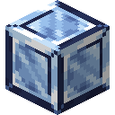{ .mc-icon title="Polished Block of Slowlight Shard" } 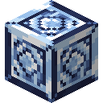{ .mc-icon title="Rhombuses Block of Slowlight Shard" } { .mc-icon title="Shiny Block of Slowlight Shard" } 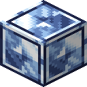{ .mc-icon title="Shiny Bordered Block of Slowlight Shard" } 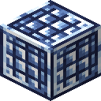{ .mc-icon title="Small Tiles Block of Slowlight Shard" } 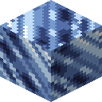{ .mc-icon title="Smooth Block of Slowlight Shard" }

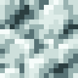{ .mc-icon title="Block of Still Shard" } 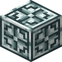{ .mc-icon title="Chiseled Block of Still Shard" } 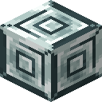{ .mc-icon title="Chiseled Cubes Block of Still Shard" } 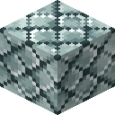{ .mc-icon title="Diagonal Tiles Block of Still Shard" } 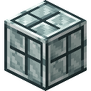{ .mc-icon title="Grid Block of Still Shard" } { .mc-icon title="Jewel Block Block of Still Shard" } 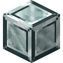{ .mc-icon title="Polished Block of Still Shard" } 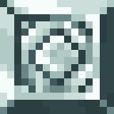{ .mc-icon title="Rhombuses Block of Still Shard" } { .mc-icon title="Shiny Block of Still Shard" } { .mc-icon title="Shiny Bordered Block of Still Shard" } { .mc-icon title="Small Tiles Block of Still Shard" } { .mc-icon title="Smooth Block of Still Shard" }

**Sulfur cubes (26.2 and 26.3, from 0.8.3).** Feed a sulfur cube a full shard block, any design, and it takes on that block's nature. A Slowlight Shard block makes a **drifting** cube: a fifth of the usual gravity, a little bouncier, and it floats slowly down. A Still Shard block makes a **still** cube: no gravity at all, so it hangs where it is and stops dead in the air when you hit it. Both take knockback like the light cube types.

**Gloamwood planks** in nineteen patterns, from the stonecutter or Rechiseled's chisel, each with stairs and slabs.

{ .mc-icon title="Beams Gloamwood Planks" } { .mc-icon title="Brick Pattern Gloamwood Planks" } { .mc-icon title="Brick Paving Gloamwood Planks" } { .mc-icon title="Bricks Gloamwood Planks" } { .mc-icon title="Crate Gloamwood Planks" } { .mc-icon title="Diagonal Stripes Gloamwood Planks" } { .mc-icon title="Diagonal Tiles Gloamwood Planks" } { .mc-icon title="Dotted Gloamwood Planks" } { .mc-icon title="Flooring Gloamwood Planks" } { .mc-icon title="Large Tiles Gloamwood Planks" } { .mc-icon title="Mosaic Gloamwood Planks" } { .mc-icon title="Pattern Gloamwood Planks" } { .mc-icon title="Rotated Bricks Gloamwood Planks" } { .mc-icon title="Small Bricks Gloamwood Planks" } { .mc-icon title="Small Tiles Gloamwood Planks" } { .mc-icon title="Squares Gloamwood Planks" } { .mc-icon title="Tiles Gloamwood Planks" } { .mc-icon title="Wavy Gloamwood Planks" } { .mc-icon title="Woven Gloamwood Planks" }

| | Block | Crafted from | What it does |
|---|---|---|---|
| { .mc-icon } | **Gloamwood Bookshelf** | Gloamwood slabs and books | powers enchanting. With Chipped installed, the carpenter's table turns it into Gloamwood versions of all 33 of Chipped's bookshelves. |
| { .mc-icon } | **Lapse Block** | eight Still Shards round a Slowlight Shard | powered, it steps out of the world for three seconds, its red ring fading to a green trace, and takes every Lapse Block it touches with it |

## Potters and old yards

**The Potter.** A villager with no job takes a Patient Kiln as a workstation and becomes a Potter. Potters buy clay,
honey and Duskbloom petals, and sell bricks, terracotta and aged goods. A master Potter parts, at a price, with the
Patience sherd and the Patience trim.

**Old potters' yards.** Out on the plains, the savanna and the badlands there are ruins of old potters' yards: a ring of
broken brick round a hearth, with a Patient Kiln someone sealed long ago and never came back for. Its batch is long
done. Brush the gravel nearby.

{ .mc-icon .mc-inline } The **Patience Pottery Sherd** stamps
an hourglass on a decorated pot. It turns up, rarely, in trail ruins and desert wells.

## A Slow Almanac

With Patchouli installed, a book and a clay ball make *A Slow Almanac*, a guide to everything here: kilns that count in
days, the weather some things wait for, and a lantern that keeps its own hours. (Not on 26.2 or 26.3, which have no
Patchouli.)

## Other mods

Each of these loads only when its mod is installed; nothing here is required. The foods from other mods show in the
creative tab only when their mod is there. Their kiln recipes are on the [recipes page](recipes.md#with-other-mods).

**Twilight Forest:** preserves for all eight of its berries and the torchberry, a cured hydra chop, jerky from venison,
meef and vanilla's cooked meats, and moss on castle brick, underbrick and mazestone brick.

{ .mc-icon title="Blackberry Preserve" } { .mc-icon title="Blightberry Preserve" } { .mc-icon title="Duskberry Preserve" } { .mc-icon title="Maloberry Preserve" } { .mc-icon title="Raspberry Preserve" } { .mc-icon title="Skyberry Preserve" } { .mc-icon title="Stingberry Preserve" } { .mc-icon title="Twilight Blueberry Preserve" } { .mc-icon title="Torchberry Preserve" } { .mc-icon title="Cured Hydra Chop" }

**The Undergarden:** cured gwibling, dweller steak and gloomper leg, ditchbulb preserve, candied droopfruit and dried
glitterkelp; blisterberries rot, and depthrock and shiverstone bricks crack.

{ .mc-icon title="Cured Gwibling" } { .mc-icon title="Cured Dweller Steak" } { .mc-icon title="Cured Gloomper Leg" } { .mc-icon title="Ditchbulb Preserve" } { .mc-icon title="Candied Droopfruit" } { .mc-icon title="Dried Glitterkelp" }

**The Aether:** white apple cider, blue berry and enchanted berry preserves, and aechor petal tea (a moment of slow
falling).

{ .mc-icon title="White Apple Cider" } { .mc-icon title="Blue Berry Preserve" } { .mc-icon title="Enchanted Berry Preserve" } { .mc-icon title="Aechor Petal Tea" }

**Aerial Hell** (which has no 26.2 or 26.3 build yet): ten kiln foods (four aerial berry preserves, shadow fruit preserve, candied
glowing stick fruit, stellar rock sugar, cured phantom and turtle meat, stellar rusk), leather from rotten leather and
venomous snake skin, moss on stellar cobblestone, mud bricks and shadow catacomb bricks, and its four flowers in the
Flower Press. The game draws five of these icons from Aerial Hell's own textures, recoloured.

{ .mc-icon title="Aerial Berry Preserve" } { .mc-icon title="Ruby Aerial Berry Preserve" } { .mc-icon title="Volucite Aerial Berry Preserve" } { .mc-icon title="Vibrant Aerial Berry Preserve" } { .mc-icon title="Shadow Fruit Preserve" } { .mc-icon title="Candied Glowing Stick Fruit" } { .mc-icon title="Stellar Rock Sugar" } { .mc-icon title="Cured Phantom Meat" } { .mc-icon title="Cured Turtle Meat" } { .mc-icon title="Stellar Rusk" }

- **Rechiseled:** its chisel cuts the shard blocks and Gloamwood planks into their variants.
- **Chipped:** 33 Gloamwood bookshelves from the carpenter's table.
- **Create:** funnels and belts tend the kilns like any hopper.
- **JEI:** every ageing recipe, with its days, its weather and its Long Kiln wait.
- **Jade:** a kiln, Sandglass or Keepsake Urn tells you how long it has left.
- **Patchouli:** *A Slow Almanac*.
- **KubeJS:** add and remove ageing recipes from scripts; see [For pack makers](packs.md).
