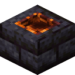
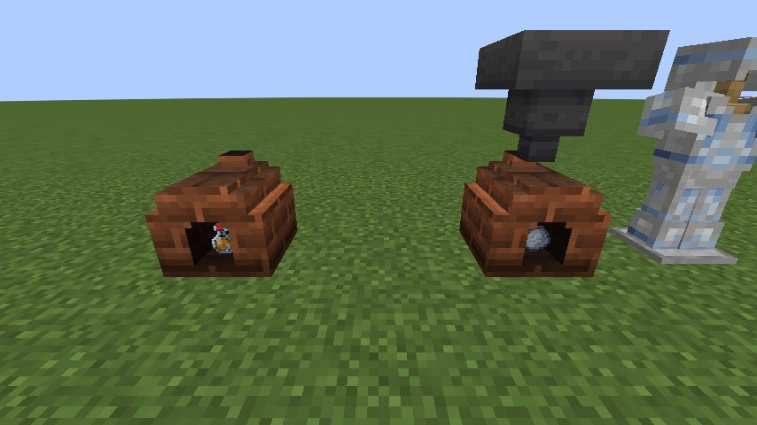
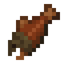
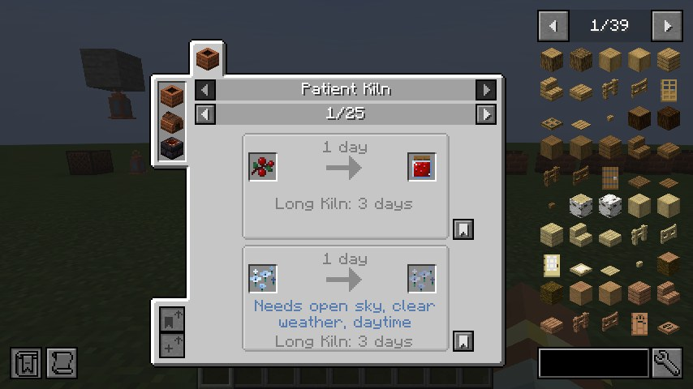

# The kilns

None of the kilns burns fuel or has a screen. You put something in, close it, and come back once its days have passed.
Every recipe and its wait is on the [Kiln recipes](recipes.md) page, and in JEI.

| | Kiln | Crafted from | Holds | Wait |
|---|---|---|---|---|
| { .mc-icon } | **Patient Kiln** | 8 bricks in a ring | one item | the recipe's days |
| { .mc-icon } | **Long Kiln** | bricks top and bottom; a mud brick between two Patient Kilns | a whole stack | three times the days, for all of it at once |
| { .mc-icon } | **Ember Kiln** | polished blackstone bricks round a Patient Kiln, a magma block below | one item | half the days, where the world is hot |

**Patient Kiln.** One thing at a time. Put it in, close the lid, come back another day.

**Long Kiln.** It takes a whole stack, bricks its door shut and finishes all of it at once, in three times the wait of
one (a recipe can set its own with `long_days`). It seals when it's full, or once nothing more has gone in for ten
seconds, so a hopper can fill it.

**Ember Kiln.** A kiln of blackstone, for the Nether. It works only where the world itself is hot, and there it needs
half the days. Anywhere cooler it holds what it's given and waits for the heat.

## How the wait works

- **The world's clock.** Days count on the world's game time, 24000 ticks to a day. Sleeping skips the night but not
  the wait, and an unloaded kiln loses nothing: the next time it ticks, it finds its days have gone by.
- **Weather.** Some recipes count only in the right weather: under open sky or roofed over, in clear weather, rain or
  a thunderstorm, by day or by night. Rain only counts where it actually falls on the kiln. While the weather is wrong
  the wait stands still, keeping the days it already has, and the kiln says what it's waiting for.
- **Dimension.** A recipe can belong to one dimension. There it wins over the same item's ordinary recipe, so
  cobblestone goes mossy in the Overworld but turns to blackstone in the Nether.

## Automation

The kilns take items from any side but the bottom and give their finished work out below, so a hopper or a Create
funnel can tend them. A comparator reads how far along a kiln is, and Jade shows the days left.

## What time makes

- **To drink:** { .mc-icon .mc-inline } Amber Draught from a bottle of honey,
  { .mc-icon .mc-inline } Cider from apples,
  { .mc-icon .mc-inline } Dusk Cider (cider and dried Duskbloom petals, crafted),
  { .mc-icon .mc-inline } Duskbloom Tea for a minute of night vision, and
  { .mc-icon .mc-inline } Lanternwine from Lanternfruit must.
- **To eat:** { .mc-icon .mc-inline } Preserved Berries and
  { .mc-icon .mc-inline } Duskbloom Jam,
  { .mc-icon .mc-inline }{ .mc-icon .mc-inline }
  cured cod and salmon that keep you fed longer, and
  { .mc-icon .mc-inline } candied Lanternfruit and
  { .mc-icon .mc-inline } Lanternfruit preserve.
- **What time does anyway:** string gathers into cobweb, coarse dirt settles into podzol, cobblestone and stone bricks
  go mossy, a honey block crystallises into sugar, cornflowers ferment into blue dye, copper weathers a stage at a time,
  and rotten flesh, left long enough, becomes leather.
- **Old things wake.** Torchflower seeds open in two days and a pitcher pod in three. Gravel or sand left a week comes
  back *suspicious*: place it, brush it, and find what settled into it (flint, bones and nuggets mostly, now and then
  an emerald, a shard or a pottery sherd).

