# Kiln recipes

Every recipe the [kilns](kilns.md) know, read from the mod's own data. The **Patient Kiln** takes the days shown; the
**Long Kiln** takes three times as long for a whole stack; the **Ember Kiln** takes half, where the world is hot
enough. JEI shows the same list in game.

A recipe with a **condition** only counts its days while the condition holds; otherwise the wait stands still and keeps
the days it has. A recipe with a dimension exists only there, and there it wins over the same item's recipe without one
(so cobblestone turns to blackstone in the Nether and mossy everywhere else).

## Slowlight and vanilla

| In | Out | Days | Long Kiln days | Condition |
|---|---|---|---|---|
| { .mc-icon .mc-inline } Honey Bottle | { .mc-icon .mc-inline } Amber Draught | 2 | 6 |  |
| 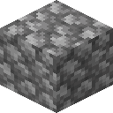{ .mc-icon .mc-inline } Cobblestone | 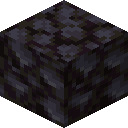{ .mc-icon .mc-inline } Blackstone | 5 | 15 | in the Nether |
| { .mc-icon .mc-inline } Cornflower | { .mc-icon .mc-inline } 2 × Blue Dye | 3 | 9 |  |
| { .mc-icon .mc-inline } Bone | 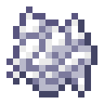{ .mc-icon .mc-inline } 6 × Bone Meal | 2 | 6 |  |
| { .mc-icon .mc-inline } Clay Ball | 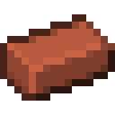{ .mc-icon .mc-inline } Brick | 3 | 9 | open sky, clear weather, by day |
| { .mc-icon .mc-inline } Lanternfruit | { .mc-icon .mc-inline } Candied Lanternfruit | 3 | 9 |  |
| { .mc-icon .mc-inline } Apple | { .mc-icon .mc-inline } Cider | 4 | 12 |  |
| { .mc-icon .mc-inline } Mud | { .mc-icon .mc-inline } 2 × Clay Ball | 2 | 6 |  |
| { .mc-icon .mc-inline } String | { .mc-icon .mc-inline } Cobweb | 3 | 9 |  |
| 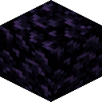{ .mc-icon .mc-inline } Obsidian | 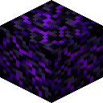{ .mc-icon .mc-inline } Crying Obsidian | 7 | 21 | nothing above it, in the End |
| { .mc-icon .mc-inline } Cooked Cod | { .mc-icon .mc-inline } Cured Cod | 3 | 9 |  |
| 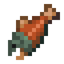{ .mc-icon .mc-inline } Cooked Salmon | 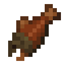{ .mc-icon .mc-inline } Cured Salmon | 3 | 9 |  |
| { .mc-icon .mc-inline } Oak Sapling | 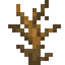{ .mc-icon .mc-inline } Dead Bush | 7 | 21 | roofed over |
| { .mc-icon .mc-inline } Duskbloom Petals | { .mc-icon .mc-inline } Dried Duskbloom Petals | 1 | 3 | open sky, clear weather, by day |
| 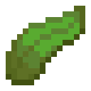{ .mc-icon .mc-inline } Kelp | 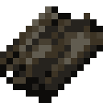{ .mc-icon .mc-inline } Dried Kelp | 1 | 3 | open sky, clear weather, by day |
| { .mc-icon .mc-inline } Block of Copper | 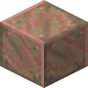{ .mc-icon .mc-inline } Exposed Copper | 3 | 9 |  |
| { .mc-icon .mc-inline } Spider Eye | { .mc-icon .mc-inline } Fermented Spider Eye | 3 | 9 |  |
| { .mc-icon .mc-inline } Lanternfruit Seeds | { .mc-icon .mc-inline } Gloamwood Seedling | 7 | 21 |  |
| 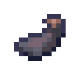{ .mc-icon .mc-inline } Ink Sac | { .mc-icon .mc-inline } Glow Ink Sac | 2 | 6 | open sky, by night |
| { .mc-icon .mc-inline } Candied Lanternfruit | { .mc-icon .mc-inline } Lanternfruit Preserve | 5 | 15 |  |
| { .mc-icon .mc-inline } Lanternfruit Must | { .mc-icon .mc-inline } Lanternwine | 5 | 15 |  |
| 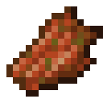{ .mc-icon .mc-inline } Rotten Flesh | { .mc-icon .mc-inline } Leather | 3 | 9 |  |
| { .mc-icon .mc-inline } Cobblestone | 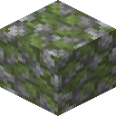{ .mc-icon .mc-inline } Mossy Cobblestone | 4 | 12 |  |
| { .mc-icon .mc-inline } Stone Bricks | 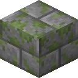{ .mc-icon .mc-inline } Mossy Stone Bricks | 4 | 12 |  |
| 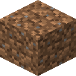{ .mc-icon .mc-inline } Dirt | { .mc-icon .mc-inline } Mud | 1 | 3 | rain |
| { .mc-icon .mc-inline } far (disc) | { .mc-icon .mc-inline } music_disc_a_week_in (disc) | 7 | 21 |  |
| { .mc-icon .mc-inline } stal (disc) | { .mc-icon .mc-inline } music_disc_lantern_hours (disc) | 5 | 15 |  |
| { .mc-icon .mc-inline } mellohi (disc) | { .mc-icon .mc-inline } music_disc_patient_light (disc) | 4 | 12 |  |
| 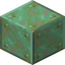{ .mc-icon .mc-inline } Weathered Copper | 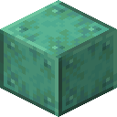{ .mc-icon .mc-inline } Oxidized Copper | 3 | 9 |  |
| { .mc-icon .mc-inline } Sugar Cane | { .mc-icon .mc-inline } Paper | 2 | 6 | open sky, clear weather, by day |
| { .mc-icon .mc-inline } Slowlight Shard | { .mc-icon .mc-inline } Patience Armor Trim | 14 | 42 |  |
| 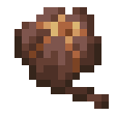{ .mc-icon .mc-inline } Pitcher Pod | { .mc-icon .mc-inline } Pitcher Plant | 3 | 9 |  |
| 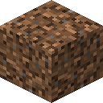{ .mc-icon .mc-inline } Coarse Dirt | 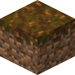{ .mc-icon .mc-inline } Podzol | 4 | 12 |  |
| 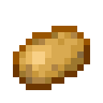{ .mc-icon .mc-inline } Potato | 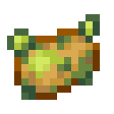{ .mc-icon .mc-inline } Poisonous Potato | 3 | 9 | roofed over |
| { .mc-icon .mc-inline } Chorus Fruit | { .mc-icon .mc-inline } Popped Chorus Fruit | 2 | 6 | nothing above it, in the End |
| { .mc-icon .mc-inline } Sweet Berries | { .mc-icon .mc-inline } Preserved Berries | 1 | 3 |  |
| { .mc-icon .mc-inline } Amethyst Shard | { .mc-icon .mc-inline } Slowlight Shard | 7 | 21 |  |
| { .mc-icon .mc-inline } Dried Duskbloom Petals | { .mc-icon .mc-inline } Slowlight Shard | 14 | 42 | open sky, by night |
| { .mc-icon .mc-inline } Sand | { .mc-icon .mc-inline } Soul Sand | 5 | 15 | in the Nether |
| 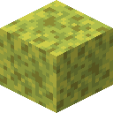{ .mc-icon .mc-inline } Wet Sponge | 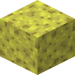{ .mc-icon .mc-inline } Sponge | 1 | 3 | open sky, clear weather, by day |
| { .mc-icon .mc-inline } Ender Pearl | { .mc-icon .mc-inline } Still Shard | 10 | 30 | nothing above it, in the End |
| { .mc-icon .mc-inline } Honey Block | { .mc-icon .mc-inline } 12 × Sugar | 5 | 15 |  |
| { .mc-icon .mc-inline } Gravel | 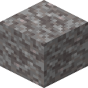{ .mc-icon .mc-inline } Suspicious Gravel (kiln finds) | 7 | 21 |  |
| { .mc-icon .mc-inline } Sand | 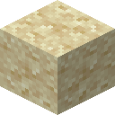{ .mc-icon .mc-inline } Suspicious Sand (kiln finds) | 7 | 21 |  |
| 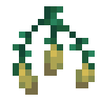{ .mc-icon .mc-inline } Torchflower Seeds | { .mc-icon .mc-inline } Torchflower | 2 | 6 |  |
| { .mc-icon .mc-inline } Glass Bottle | { .mc-icon .mc-inline } Water Bottle | 1 | 3 | rain |
| { .mc-icon .mc-inline } Bucket | { .mc-icon .mc-inline } Water Bucket | 2 | 6 | rain |
| { .mc-icon .mc-inline } Exposed Copper | { .mc-icon .mc-inline } Weathered Copper | 3 | 9 |  |
| { .mc-icon .mc-inline } Sponge | { .mc-icon .mc-inline } Wet Sponge | 1 | 3 | rain |

## With other mods

Each of these loads only when its mod is installed.

### Twilight Forest

| In | Out | Days | Long Kiln days | Condition |
|---|---|---|---|---|
| 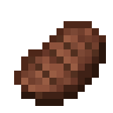{ .mc-icon .mc-inline } Steak |  Beef Jerky | 3 | 9 |  |
|  Blackberry | { .mc-icon .mc-inline } Blackberry Preserve | 4 | 12 |  |
|  Blightberry | { .mc-icon .mc-inline } Blightberry Preserve | 4 | 12 |  |
| { .mc-icon .mc-inline } Cooked Chicken |  Chicken Jerky | 3 | 9 |  |
|  Hydra Chop | { .mc-icon .mc-inline } Cured Hydra Chop | 5 | 15 |  |
|  Duskberry | { .mc-icon .mc-inline } Duskberry Preserve | 4 | 12 |  |
| { .mc-icon .mc-inline } Pufferfish |  Fugu Jerky | 3 | 9 |  |
|  Maloberry | { .mc-icon .mc-inline } Maloberry Preserve | 4 | 12 |  |
|  Cooked Meef |  Meef Jerky | 3 | 9 |  |
|  Castle Brick |  Mossy Castle Brick | 5 | 15 |  |
|  Mazestone Brick |  Mossy Mazestone | 4 | 12 |  |
|  Underbrick |  Mossy Underbrick | 4 | 12 |  |
| { .mc-icon .mc-inline } Cooked Mutton |  Mutton Jerky | 3 | 9 |  |
| 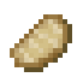{ .mc-icon .mc-inline } Cooked Porkchop |  Pork Jerky | 3 | 9 |  |
| 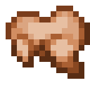{ .mc-icon .mc-inline } Cooked Rabbit |  Rabbit Jerky | 3 | 9 |  |
|  Raspberry | { .mc-icon .mc-inline } Raspberry Preserve | 4 | 12 |  |
|  Skyberry | { .mc-icon .mc-inline } Skyberry Preserve | 4 | 12 |  |
|  Stingberry | { .mc-icon .mc-inline } Stingberry Preserve | 4 | 12 |  |
|  Torchberries | { .mc-icon .mc-inline } Torchberry Preserve | 4 | 12 |  |
| { .mc-icon .mc-inline } Tropical Fish |  Tropical Fish Jerky | 3 | 9 |  |
|  Blueberry | { .mc-icon .mc-inline } Twilight Blueberry Preserve | 4 | 12 |  |
|  Cooked Venison |  Venison Jerky | 3 | 9 |  |

### The Undergarden

| In | Out | Days | Long Kiln days | Condition |
|---|---|---|---|---|
|  Droopvine Item | 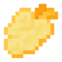{ .mc-icon .mc-inline } Candied Droopfruit | 3 | 9 |  |
|  Depthrock Bricks |  Cracked Depthrock Bricks | 3 | 9 |  |
|  Shiverstone Bricks |  Cracked Shiverstone Bricks | 3 | 9 |  |
|  Dweller Steak | 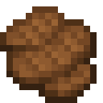{ .mc-icon .mc-inline } Cured Dweller Steak | 4 | 12 |  |
|  Gloomper Leg | { .mc-icon .mc-inline } Cured Gloomper Leg | 4 | 12 |  |
|  Cooked Gwibling | 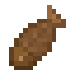{ .mc-icon .mc-inline } Cured Gwibling | 3 | 9 |  |
|  Ditchbulb | { .mc-icon .mc-inline } Ditchbulb Preserve | 4 | 12 |  |
|  Glitterkelp | { .mc-icon .mc-inline } Dried Glitterkelp | 2 | 6 |  |
|  Blisterberry |  Rotten Blisterberry | 2 | 6 |  |

### The Aether

| In | Out | Days | Long Kiln days | Condition |
|---|---|---|---|---|
|  Aechor Petal | { .mc-icon .mc-inline } Aechor Petal Tea | 2 | 6 |  |
|  Blue Berry | { .mc-icon .mc-inline } Blue Berry Preserve | 4 | 12 |  |
|  Enchanted Berry | { .mc-icon .mc-inline } Enchanted Berry Preserve | 4 | 12 |  |
|  White Apple | 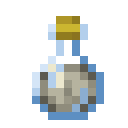{ .mc-icon .mc-inline } White Apple Cider | 4 | 12 |  |

### Aerial Hell

| In | Out | Days | Long Kiln days | Condition |
|---|---|---|---|---|
|  Aerial Berry | { .mc-icon .mc-inline } Aerial Berry Preserve | 4 | 12 |  |
|  Glowing Stick Fruit | 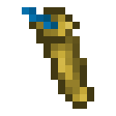{ .mc-icon .mc-inline } Candied Glowing Stick Fruit | 3 | 9 |  |
|  Cooked Phantom Meat | 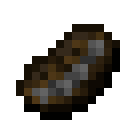{ .mc-icon .mc-inline } Cured Phantom Meat | 4 | 12 |  |
|  Cooked Turtle Meat | { .mc-icon .mc-inline } Cured Turtle Meat | 4 | 12 |  |
|  Rotten Leather | { .mc-icon .mc-inline } Leather | 4 | 12 |  |
|  Venomous Snake Skin | { .mc-icon .mc-inline } Leather | 3 | 9 |  |
|  Mud Bricks |  Mossy Mud Bricks | 4 | 12 |  |
|  Shadow Catacombs Bricks |  Mossy Shadow Catacombs Bricks | 5 | 15 |  |
|  Stellar Cobblestone |  Mossy Stellar Cobblestone | 4 | 12 |  |
|  Ruby Aerial Berry | { .mc-icon .mc-inline } Ruby Aerial Berry Preserve | 4 | 12 |  |
|  Dark Shadow Fruit | { .mc-icon .mc-inline } Shadow Fruit Preserve | 4 | 12 |  |
|  Purple Shadow Fruit | { .mc-icon .mc-inline } Shadow Fruit Preserve | 4 | 12 |  |
|  Stellar Sugar Cane | { .mc-icon .mc-inline } Stellar Rock Sugar | 3 | 9 |  |
|  Stellar Bread | 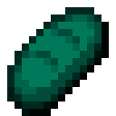{ .mc-icon .mc-inline } Stellar Rusk | 2 | 6 |  |
|  Vibrant Aerial Berry | { .mc-icon .mc-inline } Vibrant Aerial Berry Preserve | 4 | 12 |  |
|  Volucite Aerial Berry | { .mc-icon .mc-inline } Volucite Aerial Berry Preserve | 4 | 12 |  |
