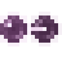
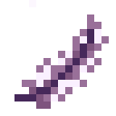
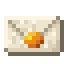

# Waystones and Nightfall

## Waystones

Set a Twin Pearl into a Waystone. It keeps one half and gives you the other. Put that half into a second Waystone to pair them. Each shipment costs a Chorus Pearl and can carry one stack. A shipment takes in-game days to arrive, and a pair can carry one shipment at a time.

| Picture | Item | What it does |
|---|---|---|
| { .mc-icon } | Twin Pearl | Links a pair of Waystones. |
| { .mc-icon } | Unfalling Feather | Carry it to drift downward. Sneak to drop at normal speed. |
| { .mc-icon } | Wandering Apple | Eat it to rise to the open sky. |

### Transit recipes

These changes happen when the right item travels along the right route. JEI also shows the routes.

| From | To | Send | Receive |
|---|---|---|---|
| Any | Nether | Red Stained Glass | Crimson Mosaic Glass |
| End | Overworld | Stone Bricks | Hollowstone |
| Any | Nether | Orange Stained Glass | Magma Mosaic Glass |
| Any | Nether | Light Blue Stained Glass | Soul Mosaic Glass |
| Overworld | End | Glass | Starglass |
| Nether | End | Candle | Starwick Candle |
| End | Nether | Glass | Tinted Glass |
| End | Any | Feather | Unfalling Feather |
| End | Overworld | Apple | Wandering Apple |
| Any | Nether | Cyan Stained Glass | Warped Mosaic Glass |

## Nightfall

| Picture | Feature | What it does |
|---|---|---|
| | Cheese Wheel | Age a milk bucket for seven days in a dark kiln, then place the wheel and eat it a wedge at a time. |
| | Moon and cellar recipes | Some recipes need a full or new moon, dark conditions or a cold biome. Amber Draught, Cider and Lanternwine age faster in a dark cellar. See [Kiln recipes](recipes.md). |
| | Moondial | Put it under open sky and read the moon phase with a comparator. |
| { .mc-icon } | Letter to Later | Seal a signed book with honeycomb for 1 to 365 in-game days. The book stays sealed until the wait is over. |
| | Moths | Gather around the Slowlight Lantern and ripe Lanternfruit. |

## For pack makers

Transit recipes use <code>slowlight:transit</code> under <code>data/slowlight/recipe/transit/</code>. Each recipe has an <code>ingredient</code>, a <code>result</code> and <code>from</code> and <code>to</code> dimensions. Use <code>"any"</code> for an unrestricted end of the route. On Forge 1.20.1, use <code>recipes/</code> and add KubeJS transit recipes with <code>event.custom</code>.
