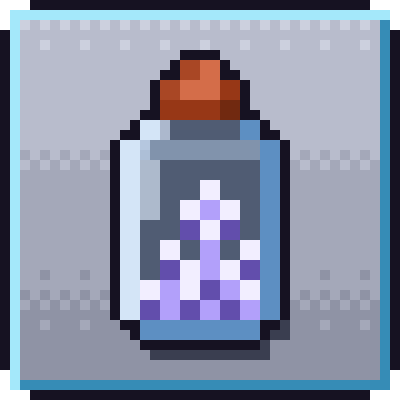

# Tempestas

{ width="140" align=right }

Tempestas lets players catch weather in jars and let it out somewhere else. Open an empty Sky Jar outside during a
thunderstorm and it catches the storm. Open that jar later at home and a small storm starts over that spot for 20
seconds, with one lightning bolt.

**Requires** [Fundamentum](../fundamentum/index.md) and [Curios](https://www.curseforge.com/projects/309927).
[JEI](https://www.curseforge.com/projects/238222) and [Jade](https://www.curseforge.com/projects/324717) are optional.

| Minecraft | Loader | Tempestas | Fundamentum |
|---|---|---|---|
| 26.1.2 | NeoForge | 0.2.0 | 2.0.0 or newer |

This guide covers the built **0.2.0** jar. It is not released yet.

There are 24 kinds of weather to catch. Rain, snow, thunder and a clear day are easy. The rest need a certain place
or time, like rain in a jungle, thunder over the ocean, a clear night above height 110 or the night of a full moon.

## Catching weather

Use an empty Sky Jar outside under open sky and it fills with whatever weather is overhead. The jar turns the colour
of that weather and its tooltip shows where and when it was caught.

Opening a full jar lets the weather out within 6 to 10 blocks of that spot, for 10 to 45 seconds.

- A jar of rain waters farmland and grows crops for 30 seconds.
- A jar of snow lays snow and freezes water for 30 seconds.
- A jar of thunder drops one lightning bolt. A jar caught over the ocean drops two and gives Conduit Power.
- A jar of dawn gives Regeneration, a jar from a mountain top gives Slow Falling and Jump Boost, and a jar from the
  Nether gives Fire Resistance.
- A jar of a clear night or dusk makes hostile mobs close by lose track of their target and stand still while it lasts.

The Weather Almanac lists all 24 and gives a hint for each one not caught yet, like "Thunder over open water."

??? note "All 24 kinds of weather"
    Clear Day, Clear Night, Rain Shower, Snowfall, Thunderhead, Dawn, Dusk, Mountain Air, Jungle Rain, Desert Noon,
    Swamp Fog, Autumn Rain, Sea Storm, Starry Night, Full Moon, New Moon, End Stillness, Nether Haze, Strange Moon,
    First Drops, Rainbow, Calm Before, Dry Thunder and Thundersnow.

## The Storm Glass

Place a Storm Glass and the crystals inside it show what the weather will do next.

| Crystals | Meaning | Comparator |
|---|---|---|
| Clear liquid | No rain for at least the next 5 minutes. | 0 |
| A few specks | Rain within 5 minutes. | 4 |
| Halfway up | Rain within a minute, or rain right now. | 9 |
| Up to the cork, glowing | Thunder within a minute, or thunder right now. | 15 |
| Sinking to the bottom | The rain is about to stop. | 2 |

A redstone build can read the comparator and close a farm roof before the rain.

Five kinds of weather only last a moment. The Storm Glass warns of them ahead of time. First Drops is the first 20
seconds of a rain. Rainbow is the first 30 seconds of sun after rain stops. Calm Before is the clear sky up to 2
minutes before thunder. Dry Thunder is a thunderstorm over a desert, where no rain falls. Thundersnow is thunder while
it snows.

A jar of Dry Thunder charges creepers nearby when opened, with no lightning bolt and no fire. Charged creepers are how
mob heads drop.

## The Weather Condenser

The Weather Condenser slowly makes an item from the air around it, one every minute.

- Ember Salt in hot, dry places like deserts and badlands.
- Rime Salt in cold places like snowy plains and frozen peaks.
- Dew Pearls in wet places like swamps and jungles.
- Storm Glass during a thunderstorm under open sky, one every 30 seconds.

The Barometer shows the temperature and humidity where the player stands and what a condenser would make there.

A salt block changes the air within 3 blocks of it. A Block of Ember Salt makes it hotter and drier. A Block of Rime
Salt makes it colder. Dewstone makes it wetter. One block next to a condenser is enough to change what it makes, so a
single base in the plains can make all four.

## Charms

Charms go in the Curios charm slot. Each one only works in its own weather, under open sky.

| Charm | Works | What it does |
|---|---|---|
| Ember Charm | Hot clear days, and anywhere in the Nether | Fire Resistance, and mobs it hits burn for 4 seconds. |
| Rime Charm | While it snows | The wearer never freezes, water freezes underfoot, and mobs it hits freeze and slow down. |
| Dew Charm | In the rain | 15% more speed and Regeneration, and crops within 4 blocks grow faster. |
| Storm Charm | In thunderstorms | Lightning can't hurt the wearer. Each hit has a 15% chance to call down a bolt on the target. |

## Compatibility

| Mod | What it does |
|---|---|
| [JEI](https://www.curseforge.com/projects/238222) | Info pages for the jars and the Storm Glass. |
| [Jade](https://www.curseforge.com/projects/324717) | Condenser progress, what a salt block does to the air, and the Storm Glass reading. |
| [Fundamentum](../fundamentum/index.md) | Temperature, humidity, seasons and element resistances. Sneak and use the Weather Almanac to open its guide book. |

## For pack makers

Every kind of weather is a datapack JSON file, so packs can add new ones, change what it takes to catch them and
change what they do when let out. All tables live under `data/<namespace>/tempestas/`.

| Path | What it sets |
|---|---|
| `skies/` | Each catchable weather's colour, priority, catch conditions and release. |
| `condensates/` | What the condenser makes in which climate, and how fast. |
| `charms/` | When each charm works and what it gives. |
| `forecast/storm_glass.json` | How far ahead the Storm Glass looks, and its comparator levels. |

Catch conditions can check the weather (clear, rain, snow, thunder, dry thunder or thundersnow), biome, time of day,
height, moon phase, Fundamentum moon, season, dimension, open sky, temperature, humidity, how long the current weather
has lasted, what the weather was before it, and what the forecast says is coming. Release effects are grow, water,
snow, freeze, melt, lightning, potion, calm and charge. A release can also set its cloud layer and the rain or snow
falling from it.

How salt blocks change the air is Fundamentum's `climate_blocks` data.

Tempestas is licensed under LGPL-3.0.
